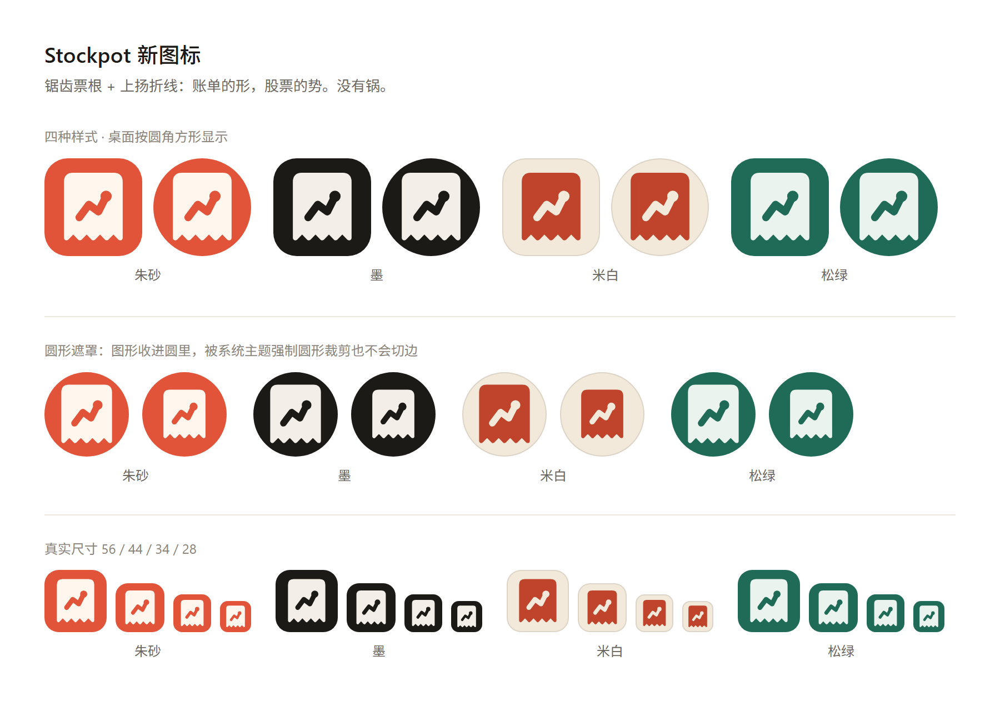

# Stockpot Mobile

桌面记账软件 [Stockpot](../stockpot) 的安卓客户端。原生 Kotlin + Jetpack Compose，
**本地优先**：账本存在应用私有目录的一份 SQLite 数据库里，不登录就永远不出这台手机；
登录是**可选项**，登录之后整份账本同步到自己的服务器（[stockpot-server](../stockpot-server)）。
行情和汇率是另一件事，那是只读的公共接口，不需要账号。

金额一律用 Barlow（DIN 那一挂的窄体数字，票据上的味道）：数字等宽，位数变化不会让整行跳；
一行放不下的金额按可用宽度缩字号，不会被省略号截断。

界面语言和账本口径跟桌面端一致，`ledger.json` 双向互通：库是库，导出的是 JSON，
手机导出的账本可以直接丢给桌面端打开，桌面端的账本也能合并进手机。

## 功能

顶栏是**当前 tab 的图标 + 页面名字**（总览=饼图 / 流水=账单 / 资产=钱包 / 设置=齿轮），不是固定的品牌字：
往下滚的时候图标和标题一起缩小（24dp/24sp → 18dp/16sp）、说明淡掉，腾出来的高度还给列表；
往回滚又一点点长回来。收起进度由列表**实际滚了多少**驱动，所以两个方向都跟手，
滚不动的页面也不会乱缩。尺寸变化先过一层临界阻尼弹簧（stiffness 240）再映射成 smoothstep，
0→1 的每一段都是缓的：起手不猛、收尾不急，中间那段才走得快。
切 tab 时图标和标题是 170ms 淡着换的，不是啪一下跳过去。
进到子页面（导入、项目、股票、账户编辑）时顶栏让位给子页面自己的返回头，省下来的空间都留给内容。
让位和页面转场是**同一段 240ms、同一条缓动**：标题往上淡走（不是被压扁裁掉），
高度收到只剩状态栏那一截——子页面的内容正好从那条线开始，转场里只上移一次，
不会先窜上去再落回来。让位时也不留空位：子页面不用自己补状态栏留白，否则就是双份。
另外，从已经滚上去的页面点进子页面时，顶栏沿用**那个 tab** 的收起进度，
不会先弹回展开态再收——那一下才是最容易看出来的"断"。

底部四个 tab：**总览 / 流水 / 资产 / 设置**，导航是一条悬浮胶囊，选中的 tab 带一块淡底色；
胶囊右边贴着圆形加号（总览、流水是「记一笔」，资产是「添加账户」），设置页没有加号，
胶囊会平滑撑满整行。
底栏是浮在内容之上的，不占布局位置：列表能滚到胶囊背后，左右两侧露出内容，而不是被一条横栏切掉。
**进到二级页面（账号、项目、股票、导入、标题整理……）它整条滑下去**，页面自己带返回头；
这些页面的列表底部留白跟着系统导航条走（`overlayBottomPadding()`），不再固定让出胶囊那 108dp。

按钮有轻触震动：切 tab、加号、chip 选择、分段切换、开关、保存/删除都给一下，
其中保存和删除更沉一点；滚动、输入框、返回、普通列表行不给——高频动作一路震反而烦人。

- **总览** — 月/年两个视角：支出、收入、结余、日均、笔数；每日支出图（柱子/曲线点一下互换）；
  分类环形图与排行；月度日历（格子按当天花销着色，点一天看当天流水）；最近记录；
  底部是**项目入口**，露最近三个项目，点「全部」进项目页。
  **左右滑可以换月份**（「年」视角下一次翻一整年），月份条固定在上面不跟着晃；
  下拉刷新会对一次云端、顺手刷行情。
- **流水** — 按月列出，按日分组并显示当日收支；点任意一行编辑，长按弹删除确认（删了有 3.6 秒撤销）。
  **左右滑换月份**、**下拉刷新**跟首页一套。
  页头只有月份、搜索框和**筛选**按钮，条件都收进筛选弹层：类型、**类目**、账户、金额范围、
  时间范围（跟随月份 / 近 7 天 / 近 30 天 / 本月 / 自定义起止）、排序
  （时间或金额、升降序都行），底部直接写「查看 N 条」。生效的条件会以标签排在列表上方，
  点一下就撤掉；筛了自定义日期区间后，顶部月份变成区间文案，翻月会清掉区间再按月看。
  选了金额排序时列表**不再按日分组**——分组会把新日期的小额整批压到旧日期的大额后面，
  顺序就乱了；这时平铺当月全部记录，每行右侧用日期代替时间。
- **资产** — 每个账户的余额（储蓄卡、零钱、信用卡、投资、公积金、医保……）：净资产、总资产、
  总负债，一条按类型的资产构成色带，下面按类型分组列出账户。点账户进编辑页。
  添加账户分两步：先选类型，再填名称、备注、余额；「计入总资产」关掉后余额只留在列表里，
  「记账时可被选择」决定它是否出现在记一笔的账户候选里。
  **信用卡填的是「下月待还」**：输入正数就行，落库存成负数，资产页显示成负的待还金额，
  净资产自动扣掉；老账本里填成正数的信用卡余额在载入时会被翻过来。
  余额是手工维护的快照，不会跟着账目自动变。
  类型页会把**导入账单里识别出来、但还没建成账户的名字**列在外面，点一下就连名字带类型建好，
  账户名会直接填进表单；类型也可以自己起（比如「数字钱包」），自定义类型直接参与分组和统计。
- **记一笔 / 编辑账目** — 同一张表单。大号金额输入、支出/收入/转账、分类树选择（可现场新建）、
  日期快捷选项与日历、**具体时间**（表盘，可清空）、商家、账户（**从列表里选**，也能现场新建）、备注、项目（一行下拉挑，
  项目名再长也不会像 chip 那样挤到屏幕外）。
  它是**整页**：点一行流水时，这一页从那一行的位置摊开（默认是**折叠**：那一行中间先裂开一条缝，
  上下两条边各走各的，纸一边长高一边从 0.74 倍放大到 1 倍，内容过半才淡上来，
  上边始终贴着纸口、不会被切掉；后面那一页同时缩一点、四角收圆、压暗一层），
  关掉时原路缩回那一行里。打开动画可以在**设置 → 显示**里换成「缩放」（iOS 应用打开那种整页放大）、
  「侧滑」（从右边滑进来）或「上推」（从屏幕底下推上来，顶上带圆角）。「记一笔」没有来源行，
  就从底栏那颗加号长出来。
  头部钉在顶上，**保存钉在右上角**，不用滚到底部才能保存；标题下面写明哪天、几点。
  改已有账目时，下面多一块**「退款关联」**：支出看「退回来的那一笔」，退款行看「原来是哪一单」，
  两边的金额、日期、商家都在卡片上，**点一下直接跳到对面那条**，左上角有返回箭头原路退回来。
  **任何一条账目**都能从这里手动关联（以前要「已经退过一点」才看得见这张卡，新消费根本没入口），
  候选按「金额一致 → 日期近」排，金额对不上也能放开挑、旁边写着差多少；
  配好之后钱只算一次、两条都能互跳，配错了当场「解除关联」。
  全额退款的条目在列表里原金额带一道删除线，副标题写「已全额退款」，不会看着像这个月真花了这么多。
  再下面是**「这条的来历」**：来源（微信 / 支付宝 / iCost / CSV / 手记）、
  具体时间、「退款记录、不计入合计」这类状态、平台交易单号、记录时间。
  这些都是表单改不了但看账时想知道的信息。

除记一笔之外的表单、选择器、确认框统一是**底部弹层**（`PotSheet`）：从下面推上来、键盘不挡输入框，
全应用没有 AlertDialog 了（日期选择也放在弹层里）。
- **设置** — **配色**（马卡龙 / 暖纸）、主题（跟随系统/浅/深）、**打开条目的动画**（折叠 / 缩放 / 侧滑 / 上推）、
  **图标样式与圆形遮罩**、**账号**（独立子页面）、
  **分类管理**、**关键词规则**、**退款配对**（各自独立一页，见下）、**条目标题整理**、
  **导入账单**、导出/导入账本、示例数据、清空流水，最下面是关于与**检查更新**。
  主题、动画这些分段控件都是「图标 + 文字 + 选中底色」，不再是排成一行的纯文字；
  设置里的每一行行首都有一个圆角小色块图标。
- **分类管理**（设置 → 账本）— 一整页的树：搜索框在上，分组可以展开收起（默认全开），
  点分组名折叠、点右边的笔改名、铅笔旁边的 + 在该分组下新建子分类、垃圾桶删除（删前问一句）。
  搜索时按名字过滤，命中的分组自动展开。
- **关键词规则**（设置 → 账本）— 同样是一整页：按关键词或分类名搜索，
  一条规则点进去关键词和分类都能改，不用删了重加。
- **退款配对**（设置 → 账本）— 待配对的退款、还能退的支出、已经配好的对，三个分组各一屏：
  搜索（平台、分类、账户、金额都能搜）、时间范围、「只看金额对得上」三道筛子；
  选中一条，底下出现「挑对应的那笔」，弹层里按金额和日期排好，差多少写在旁边，一眼认账。
  待配对里「金额正好、日期最近且唯一」的还能顶上一键自动配对，拿不准的留给人挑。
- **条目标题整理**（设置 → 显示）— 美团、淘宝闪购这类账单，交易对方只写平台名、
  买了什么反而在备注里，列表一屏下来全是「美团」。这一页按规则扫出命中的条目，
  先摆出**换完之后的样子**（主行是备注、下面一行 `原「美团」`），勾选后一键对调。
  只动标题和备注两段文字，金额、分类、时间、单号一概不碰；换错了再换一次就回去了。
  已收起的条目和备注为空的条目不会出现在结果里。
  规则两种：内置六条平台（美团 / 淘宝闪购 / 饿了么 / 京东 / 抖音 / 拼多多，可整组开关），
  以及**自己加的关键词**（最多 12 个字，重复的和内置已有的会被挡掉，加入即生效，× 删掉即失效）。
  开关与自定义词都记在本机，下次进来还在。

**股票** 也走子页面：总览里的股票卡 → 股票总览（市值、今日/持仓盈亏）→ 某个券商账户 → 单只票详情。
可以建多个券商账户，每个账户里多只票（成本价 + 股数），A 股 / 港股 / 美股都能记。

- 股票总览里，每个券商账户卡片都带一条**近一个月市值曲线**，右侧写区间涨跌（金额 + 百分比）
- 账户页有一张**收益走势**卡：1 个月 / 3 个月 / 1 年，可以切**市值 / 盈亏 / 收益率**三条曲线
  （盈亏和收益率以 0 轴为虚线），按持仓 × 每日收盘价逐日算；手指按上去左右拖动，
  顶部显示那一天的日期和数值，松手回到最新
- 点某只票进详情：**当日分时**（按住拖动看某一分钟的价格和相对昨收的涨跌）和**日 K**
  （前复权，最近 90 根，涨红跌绿，叠 MA5 / MA20；拖动查看那一根的开、高、低、收和涨跌幅）
- 行情走腾讯 `qt.gtimg.cn`（GBK，无需 key），分时与日 K 走 `web.ifzq.gtimg.cn`；
  日 K 一次拉 260 根（约一年交易日），进页面自动拉一次、也能手点刷新；
  拉不到就按成本算，不编造价格和曲线
- 股票市值计入资产页的净资产和「资产构成」，作为一个独立的账户分组

**项目** 不再是 tab，而是首页推进去的子页面（带返回）：总览底部卡片 →「全部」→ 项目列表 →
项目详情。项目只是分组，不改变分类和金额；删除项目只解除分组，账目一条不删。
项目详情里可以批量「添加账目」。

**导入** 同样不是 tab，是设置里的入口（也是一层可返回的页面）：微信 `.xlsx`、支付宝 `.csv`、
iCost、通用 CSV、桌面端 `ledger.json`。导入前先预览（新增/重复/忽略、收支合计、日期范围、样例行），
确认后才写入。在微信/支付宝里直接「分享到 Stockpot」也会落到这个页面。

金额一律以 **分**（`Long`）存储，汇总不会漂移。支出用红、收入用绿（国内习惯）。

## 云端同步（可选）

不登录时这一整套都不存在：没有账号，没有网络请求，账本只在本机。
登录之后才有同步，入口在**设置 → 账号**——那是一页独立的设置子页面，不再是一个弹层。

- **同步什么** — 整份账本，包括账目、分类、规则、钱包、项目、股票池和券商账户。
  不是逐条 diff：账本本来就是一份 JSON，推的就是这份文档。
- **什么时候同步** — 改完停手 4 秒推一次；回到前台对一次账；点「立即同步」马上来一次。
  没网就安静失败，下次改动或进前台再试，记账不受影响。
- **换手机** — 装好应用 → 设置 → 登录同一个账号 → 云端那份合进来，接着记。
- **删掉的东西不会再冒回来** — 每次本地改动都会比对前后两份账本，把消失的记录记成墓碑
  （`"entries:id" -> 删除时间`，存在 `sync-state.json`），随快照一起推上去。
  另一台设备拿到墓碑就把那条清掉，不会因为"它那边还有"又推回来。
- **两台设备都改了同一条** — 条目取并集，冲突的那条看本机自上次同步后有没有动过：
  没动过就以云端为准，动过就以本机为准。宁可留一条旧的，也不让刚记的一笔被旧快照盖掉。
- **服务器是自己的** — 默认 `https://api.stockpot.neeto.cn`，在登录页那一栏可以改成任意自建地址
  （`STOCKPOT_SERVER` 也能在打包时改默认值）。服务端就是一个 Express + 一份 SQLite，
  代码和部署说明在 [stockpot-server](../stockpot-server)。
- **退出登录** — 只清登录状态，本机账本一个字都不动；云端那份也还在。

发布版只允许 https（`usesCleartextTraffic=false`），debug 版放行明文，
方便在本机或局域网起一个服务对着调。

## 账号页

设置里的「账号」是一页独立的子页面（`ui/screens/AccountScreen.kt`），顶栏带返回，
不再是压在设置页上的弹层。没登录时讲清楚「不登录也能用，登录只是多一份备份」，
给登录/注册两个口子，服务器地址也在这一页改；登录之后这里就是同步的控制台：

- 这台设备：邮箱、昵称、服务器、上次同步、本机有没有还没推上去的改动
- 立即同步（同步中时按钮自己变成「同步中…」）
- 清空云端备份（本机账本不动）、退出登录（只清令牌，账本一个字不动），两个危险动作都要过一次确认

设置页里只留一行：没登录写「登录与同步」，登录后写「已登录 · 昵称」，
下面一行小字就是当前同步状态；点这一行进账号页。

## 应用内更新

安装包从服务端的**管理台**发（见 [stockpot-server](../stockpot-server) 的 README），
App 这边不经过应用商店，也不需要登录：

- **什么时候查** — 每次启动静默查一次（`PotApp` 里 `updater.check(silent = true)`），
  设置 → 关于里点「检查更新」是手动查，失败会说话。
- **显示什么** — 关于卡片里一行版本号加状态：已是最新 / 有新版本 / 下载中 N% / 安装包已下载。
  有新版才把说明、大小、versionCode 摊开，强制更新的版本在那一行里标一句。
- **怎么装** — 下载走 OkHttp 流式写文件，不整个读进内存；边写边算 SHA-256，
  跟服务端给的 `sha256` 对上才允许安装，对不上就当没下过。
  装的时候通过 `FileProvider` 把 `updates/` 里的 apk 交给系统安装器，
  系统不让装未知来源就先跳到「安装未知应用」那一页，回来再点一次。
- **不留垃圾** — `updates/` 里只留当前这一版，装了新版或查到没有更新时，旧包一起清掉。

`REQUEST_INSTALL_PACKAGES` 权限和 FileProvider 的 authority 都在清单里，
`res/xml/file_paths.xml` 只放出 `updates/` 这一个目录——别的文件系统安装器也拿不到。

## 支持的账单

| 来源 | 格式 | 说明 |
| --- | --- | --- |
| 微信支付 | `.xlsx` | 按表头 `交易时间/交易对方/商品/收/支/金额(元)` 识别，前几行说明自动跳过 |
| 支付宝 | `.csv`（通常 GBK） | 两代表头都认；`付款时间` 优先于 `交易创建时间` |
| iCost | `.xlsx` / `.csv` | 保留 `一级分类/二级分类` 两级分类 |
| 通用 CSV | `.csv` | 日期 + 金额即可；有 `支出金额`/`收入金额` 分列也能读，银行流水多能进来 |
| Stockpot 账本 | `.json` | 按 id + 去重键合并，重复导入不产生重复账目 |

解析规则（与桌面端一致）：

- **按列名找列，从不按位置**——用户会改文件名，平台也会改格式。扩展名不作数，靠字节判断是不是 zip。
- 微信的 `交易时间` 可能是 Excel 日期序列号（`46348.4575`），会换算成 `2026-11-22 10:58`。
- 支付宝的 GBK 用 GB18030（GBK 超集）解码；UTF-8 先试，失败再退回。
- `交易关闭/失败/已撤销/已取消` 的行丢弃；`退款` 的行保留。
- 微信会改写原消费行的状态（`已全额退款`），直接记在原行上；支付宝的独立退款行按
  「同平台、45 天内、余额够、金额尽量相等」匹配到原始消费，退回来的钱记进原行的
  `refundedAmount`，**退款行本身也留着**（标成不计入合计）——两条互相记着对方的 id
  （`refundLinkId`），所以从任何一边都能跳到另一边。没配上原消费的退款行同样保留，等着手动关联。
- 退款记录里的 `refundLinkId` 是手机端加的字段，桌面端读到会忽略（它的 `refundedAmount` /
  `refundedAt` 照旧工作），所以账本文件依然双向互通。
- `/` 和 `不计收支` 视为账户互转，可见但不计入收支；余额宝/零钱通的「收益发放」算收入。
- 去重键：有交易单号用单号，没有就用 `来源:日期:金额:对方`。
- 分类：先按关键词规则（最长命中胜出，方向不符的规则跳过），再看平台自己的分类标签，
  最后才猜；猜不中就归「其他」。

## 数据

```jsonc
{
  "entries": [
    {
      "id": "…", "date": "2026-11-22", "time": "12:20",
      "kind": "expense", "amount": 1850, "category": "餐饮/午餐",
      "account": "微信零钱", "counterparty": "楼下小馆", "note": "",
      "source": "wechat", "externalId": "4200001…",
      "excluded": false, "archived": false,
      "refundedAmount": 0, "refundedAt": "",
      "categoryLocked": false, "projectId": "", "createdAt": "2026-11-22T04:20:11Z"
    }
  ],
  "categories": [{ "name": "午餐", "parent": "餐饮", "kind": "expense", "icon": "food" }],
  "accounts": ["微信零钱"],
  "imports": [{ "id": "…", "file": "微信支付账单.xlsx", "source": "wechat", "added": 128, "skipped": 3 }],
  "wallets": [{ "id": "…", "name": "招商银行", "kind": "debit", "balance": 4286500 }],
  "projects": [{ "id": "…", "name": "杭州出差", "startDate": "2026-11-12", "endDate": "2026-11-14" }],
  "rules": [{ "id": "seed-0", "pattern": "星巴克", "category": "餐饮/咖啡" }],
  "ignoredDuplicates": [],
  "ignoredRepayments": [],
  "schemaVersion": 4
}
```

字段名与桌面端 `ledger.json` 完全一致（camelCase），老版本里 `categories` 是纯字符串数组，
两种都能读。

落盘方式：`databases/ledger.db`（SQLite）。一次编辑只写动过的那几行——账目按 id 比对新旧两份，
只 upsert 改过的、只删真没了的；分类、规则这类有序小表顺序变了就整表重写。编辑后 180ms 防抖，
切到后台立刻 flush。

从 0.16 及以前的版本升上来时，第一次启动会把 `filesDir/ledger.json` 读进库，
然后把原文件改名成 `ledger.imported.json` 留档——不删，迁移出岔子还能捞回来。
导出走的仍是 JSON：`ledger.json` 是两端交换用的格式，库里存的是表，不是那份文本。

## 图标



图形是**齿口票根 + 上扬折线**：票根指向账单，折线加端点的数据点是股票。没有锅。

自适应图标（Android 8+）只露中间 72dp，所以图形按 108dp 画布设计、主体控制在中心
半径 33 的圆里——被系统裁成圆角方形、圆形还是水滴，都不会切到内容。

设置里能换四种样式，另有一个「圆形遮罩」开关：

| 样式 | 底色 | 图形 |
|---|---|---|
| 朱砂 | `#E1543A` | 米白（默认） |
| 墨 | `#1C1A17` | 米白 |
| 米白 | `#F2E9DA` | 砖红 |
| 松绿 | `#1F6B57` | 淡绿 |

**实现方式**：manifest 里每种样式（× 是否遮罩）各一个 `activity-alias`，都指向
`MainActivity`，同一时刻只有一个 `enabled`。切换就是 `setComponentEnabledSetting`
先开新的、再关旧的（顺序反了中间会有一瞬间没图标，桌面会以为应用被卸载），
带 `DONT_KILL_APP`，切完还能接着用。`MainActivity` 自己不挂 `LAUNCHER`，
否则会永远多出一个关不掉的入口。

> 注意：`aapt dump badging` 不会列出 alias 形式的启动入口（这是 aapt 的已知缺陷，
> 系统侧正常注册），所以别拿它判断图标有没有生效，装到机器上看。

遮罩版把图形缩到 0.78，专门对付那些会把自己的形状强加给图标的主题。
有些桌面会缓存图标，切换后没反应的话重启桌面。

## 技术栈与结构

Kotlin 2.1 / Compose（BOM 2024.12）/ Material 3 / kotlinx.serialization / minSdk 26。
没有数据库、没有 DI 框架、没有导航库——单 Activity + 一个状态源，够用且启动快。

```
app/src/main/java/cn/neeto/stockpot/
  PotApp.kt                 Application：持有 store 与 settings
  MainActivity.kt           单 Activity，处理系统分享进来的文件
  core/model/Ledger.kt      账本模型、默认分类树与规则、老格式兼容
  core/data/LedgerMath.kt   金额/日期格式化、月汇总、每日趋势、年度视图
  core/data/LedgerOps.kt    所有编辑操作的纯函数（新增/改/删/分类/规则/项目/钱包/示例数据）
  core/data/LedgerDb.kt     SQLite 建表与读写：账目增量写、小表整表重写、持仓子表
  core/data/LedgerStore.kt  内存快照 + 防抖落库，老 ledger.json 自动迁移
  core/importer/XlsxReader.kt  极简 xlsx 读取（zip + XmlPullParser，不引 POI）
  core/importer/BillParser.kt  微信/支付宝/iCost/通用 CSV 的行解析
  core/importer/ImportEngine.kt 预览、去重、退款匹配、关键词归类、账本合并
  core/settings/SettingsStore.kt 配色、主题、动画、图标、同步服务器等偏好
  core/settings/AppIcon.kt  图标样式表与 activity-alias 切换
  core/net/ApiClient.kt     同步与版本接口的瘦客户端（OkHttp）
  core/net/SyncManager.kt   拉→合→推，防抖与冲突重试
  core/net/Updater.kt       检查更新、下载校验、交给系统安装器
  core/util/Documents.kt    SAF 文档读写
  ui/PotRoot.kt             四个 tab 的路由、叠加页层级与切换动画、记一笔入口、撤销条
  ui/PotViewModel.kt        状态与所有写操作
  ui/theme/Theme.kt         两套纸（马卡龙 / 暖纸）× 深浅、图表色与排版
  res/font/barlow_*.ttf     金额用的数字字体（OFL，见 docs/Barlow-OFL.txt）
  ui/components/            卡片、分段控件、日历、环形图、流水行、左右滑翻月、下拉刷新、编辑页四种过场
  ui/screens/               总览 / 流水 / 资产 / 设置 / 账号 / 分类管理 / 关键词规则 / 项目列表与详情 / 导入页 / 记一笔
app/src/test/java/…         84 个单元测试：解析、去重、退款、汇总、分类改名、JSON 兼容、日期换算、金额格式、筛选、标题交换、股票搜索、同步协议、安装包下载校验
```

## 构建

```bash
./gradlew :app:assembleRelease    # app/build/outputs/apk/release/app-release.apk（已签名、R8）
./gradlew :app:assembleDebug      # app/build/outputs/apk/debug/app-debug.apk（包名带 .debug）
./gradlew :app:testDebugUnitTest  # 单元测试
```

`local.properties` 里的 `sdk.dir` 指向本机 Android SDK。

签名配置在 `keystore.properties`，key 在 `keystore/stockpot-release.jks`（密码 `stockpot2026`，
alias `stockpot`）。这两个文件跟着仓库走：**同一个 key 才能覆盖安装**，删了或换机器生成新 key，
已经装在手机上的版本就只能卸载重装。

release 开了 R8（包体约 1.5 MB）。`proguard-rules.pro` 里保留了 kotlinx.serialization 的
`$$serializer` 和模型字段名——那是 `ledger.json` 的 key，不能被混淆掉。

从更早的 debug 包换到 release 时签名不同，需要先在设置里「导出账本」，卸载旧包，装好后再导入。

## 字号与热区

0.3.0 把整套排印往上抬了一档：正文 15sp、说明 13sp、小标签 12sp，金额 17sp 起，
标题 22sp。分类管理和关键词规则两个弹层的行高、删除按钮都放大到 40dp 以上，
设置项纵向留白加到 15dp——一列能点的地方基本都是拇指能稳稳按住的尺寸。

## 性能上做的几件事

列表滑动卡顿基本都来自「每帧都在做重复的工作」，这一版清掉了这些：

- 金额格式不再每次 `new DecimalFormat` + `BigDecimal`，改手写千分位拼接；`shortDate` 用字符串切片，
  `dayLabel` / `weekday` 带缓存。一屏几十行金额、42 格日历不再各建一个 formatter。
- 日历 42 个格子共用一个 `pointerInput`，不再每格挂一个 `Modifier.clickable`（省掉 42 个 ripple 节点）。
- 柱状图、环形图的比例、颜色、刻度文字都在 `remember` 里算好，绘制阶段只画。
- 股票曲线和 K 线用一条 `awaitEachGesture` 处理「按下 → 拖动 → 抬手」，
  不是每个点挂一个可点区域；K 线的 MA 也只算一次。
- 顶栏的收起高度靠 `NestedScrollConnection` 的 `onPostScroll`（读 `consumed`，不是手指位移）驱动，
  不经过 `Scaffold`：整页没有 `Scaffold` 包着，顶栏高度变化只引起布局重排；
  收起进度用 lambda 交给顶栏，滚动时只有顶栏那一小块重组合。
- 卡片默认只画圆角背景，不再 `clip()` 建图层；只有可点的卡片才 clip（为了 ripple 边界）。
- 账本模型打了 `@Immutable`，账本没变时列表项可以跳过重组；`LazyColumn` 加了 key 与 contentType。

## 与桌面端的差别

桌面端还有菜单栏读数、CLI 和 AI 分类。手机端**只做记账和自己的行情**：
账本全在本机，导入、归类、汇总都不出设备；联网只发生在拉腾讯行情和汇率的时候。
不接 CLI/MCP，也不调用模型分类。
